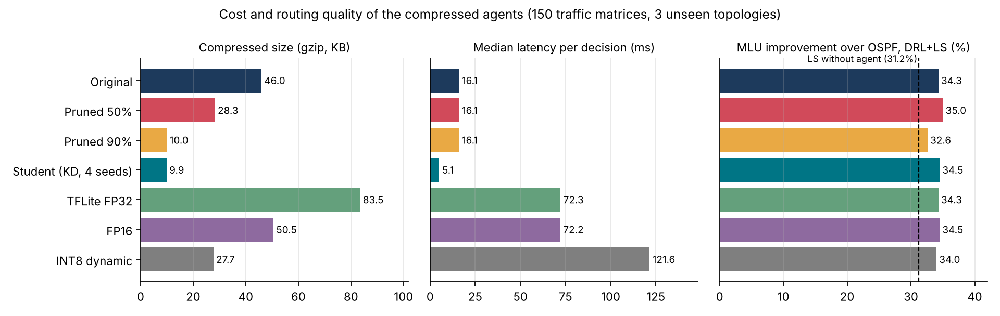
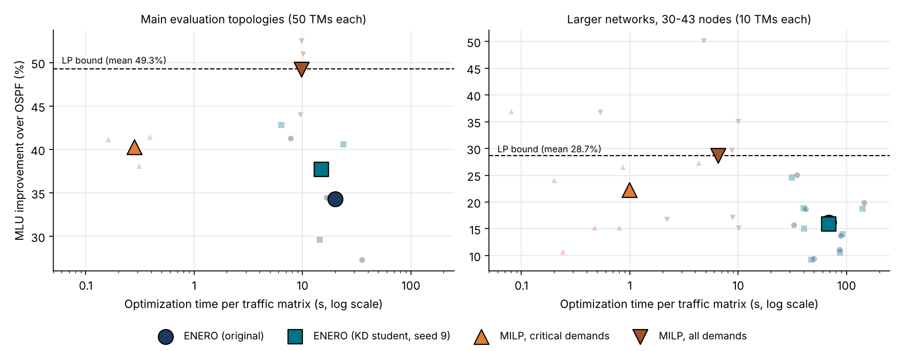

# Compressing a DRL+GNN Traffic Engineering Agent: Pruning, Quantization and Distillation of ENERO

[](LICENSE)


🇪🇸 [Leer en español](README_es.md)

Bachelor's thesis (Trabajo Fin de Grado) in Telecommunication Technologies Engineering, **University of Granada** (ETSIIT, 2026).
**Author:** Marino Ramírez Pulido · **Supervisor:** José Camacho Páez · **Grade:** 10/10

📄 **Full thesis (in Spanish, with an English abstract):** [`thesis/proyecto.pdf`](thesis/proyecto.pdf)

---

## TL;DR

[ENERO](https://github.com/BNN-UPC/ENERO) is a traffic engineering (TE) optimizer for wide area networks. A Deep Reinforcement Learning agent with a Graph Neural Network (DRL+GNN) chooses a middlepoint for each critical demand, and a Local Search (LS) then refines the solution. This project studies whether **neural network compression** can reduce the cost of running that agent without degrading the routing.

- I **migrated ENERO to Gymnasium**, adapted its training to run on a CPU (~87 h), and **found and fixed a systematic bias** in the reward function.
- I applied **magnitude pruning** (50 % and 90 %, with PPO fine-tuning), **post-training quantization** (TFLite FP16 and dynamic-range INT8) and **knowledge distillation** into a student with 4.6× fewer parameters.
- I evaluated every model on **10 unseen topologies** (20–43 nodes) against OSPF, LS, a **linear programming (LP) bound** and an **exact MILP formulation**, using paired statistical tests.

**Main findings**

1. **Compression preserves routing quality.** With LS, all compressed models improve OSPF's maximum link utilization (MLU) by 32.6–35.0 % on average, compared with 34.3 % for the original.
2. **Distillation is the best fit for a general-purpose CPU.** The student speeds up inference **3.2×** and cuts energy per optimization by **up to 25 %**. Pruning and quantization only reduce model size.
3. **The neural network is not the bottleneck.** Local search takes about 70 % of the optimization time.
4. **The negative result that matters:** for networks of this size, an **exact MILP is better than ENERO**, original or compressed. It does better on all 10 topologies, runs **~70× faster** and needs **no training**. Compression does not change this, because ENERO's disadvantage comes from its approach, not from the size of its neural network.

---

## Results

### Cost and quality of the compressed models



| Model | Non-zero parameters | Size (gzip) | Median latency / decision | MLU improvement over OSPF (DRL + LS) |
|---|---:|---:|---:|---:|
| Original | 12,737 | 46.0 KB | 16.1 ms | 34.3 % |
| Pruned 50 % | 6,577 | 28.3 KB | 16.1 ms | 35.0 % |
| Pruned 90 % | 1,647 | 10.0 KB | 16.1 ms | 32.6 % ¹ |
| **Student (KD)** | **2,753** | **9.9 KB** | **5.1 ms** | **34.5 %** ² |
| TFLite FP32 | – | 83.5 KB | 72.3 ms | 34.3 % |
| TFLite FP16 | – | 50.5 KB | 72.2 ms | 34.5 % |
| TFLite INT8 (dynamic) | – | 27.7 KB | 121.6 ms | 34.0 % |
| *LS without agent* | – | – | – | *31.2 %* |

Mean over 150 traffic matrices of three unseen topologies (EliBackbone, HurricaneElectric, Janetbackbone).
¹ The only statistically significant difference from the original (Wilcoxon, p = 0.0008). ² Mean of 4 distillation seeds; individual students range from 32.3 % to 37.7 %.

Unstructured pruning keeps the dense matrices, so it does not reduce latency on a CPU. TFLite is slower here because the 8 message-passing iterations unroll into about 300 elementary operations that the interpreter runs one at a time.

### ENERO vs. the exact formulation



| | ENERO (original) | ENERO (student) | MILP, critical demands | MILP, all demands | LP bound |
|---|---:|---:|---:|---:|---:|
| 3 main topologies: improvement / time | 34.3 % / 20.0 s | 37.7 % / 14.9 s | 40.3 % / **0.28 s** | **49.2 %** / 9.8 s | 49.3 % |
| 7 larger networks: improvement / time | 16.2 % / 68.5 s | 15.9 % / 68.3 s | 22.3 % / **0.99 s** | **28.7 %** / 6.5 s | 28.7 % |

The MILP over the critical demands solves *the same problem as ENERO's DRL stage* to optimality in under one second. The MILP over all demands comes within 0.4 % of the LP bound. A DRL agent might only pay off on much larger networks, where the exact method stops being tractable; this work could not test that.

---

## What I added on top of ENERO

| Contribution | Where |
|---|---|
| Migration of the `gym-graph` environments from OpenAI Gym to **Gymnasium** | `code/gym-graph/` |
| **Reward bias fix**: a new environment, `GraphEnv-v17`, plus a script that quantifies the bias of v16 | `environment17.py`, `analysis/reward_bias.py` |
| CPU training in resumable chunks of subprocesses (works around TensorFlow memory leaks) | `training/` |
| Magnitude pruning with fixed masks (GRU included) and PPO fine-tuning, plus a sweep without retraining | `compression/prune.py`, `compression/pruning_sweep.py` |
| TFLite conversion (FP32, FP16, dynamic INT8, full INT8) with fidelity checks | `compression/quantize.py` |
| Knowledge distillation (KL divergence at temperature τ, mixed teacher/student rollouts) | `compression/distill.py` |
| Unified evaluation: latency, size, decision agreement, DRL + LS and LP bound | `evaluation/evaluate.py` |
| **Exact middlepoint MILP** (SciPy/HiGHS) over the critical demands or all demands | `evaluation/milp.py` |
| Scalability study on 7 larger Topology Zoo networks, seed study, thread/latency study | `evaluation/run_*.py`, `analysis/` |

---

## Repository structure

```
enero-drl-compression/
├── thesis/                  # LaTeX sources and PDF of the thesis (Spanish)
├── docs/img/                # Figures used in this README
└── code/
    ├── config.py            # Dataset location (or set ENERO_DATASETS)
    ├── gym-graph/           # Gymnasium environments: Env15 (LS), Env16 (original reward), Env17 (fixed reward)
    ├── agent/               # GNN actor and critic
    ├── training/            # PPO training of the base agent
    ├── compression/         # Pruning, pruning sweep, quantization, distillation
    ├── evaluation/          # Evaluation, local search, MILP, scalability/seed/latency studies
    ├── analysis/            # Reward-bias study, OSPF reference, summaries
    ├── figures/             # Scripts that draw the thesis figures (output in figures/output/)
    ├── utils/               # Dataset conversion
    ├── models/              # Trained models: base, pruned_50, pruned_90, pruning_sweep, student,
    │                        #   student_seeds, student_configs, tflite
    ├── results/             # Every result in the thesis (CSV/JSON)
    └── logs/                # Training log of the base agent
```

All the results are included, so the tables and figures can be regenerated **without retraining anything**. File and column names inside `results/` are in Spanish, as in the thesis.

---

## Setup

The code was developed and tested on **Windows with Python 3.10**, CPU only. It should also run on Linux.

**Python 3.10 is required**: `tensorflow-cpu==2.10.0` is not available for newer versions. If you do not have Python 3.10, you can create the environment with conda instead of venv: `conda create -n enero python=3.10` and `conda activate enero`.

```bash
python -m venv venv
# Windows: venv\Scripts\activate    ·    Linux/macOS: source venv/bin/activate
pip install -r requirements.txt
pip install -e code/gym-graph
```

### Dataset

The topologies and traffic matrices come from the **ENERO dataset**, which is not redistributed here. Download it following the [instructions of the original ENERO repository](https://github.com/BNN-UPC/ENERO#instructions-to-prepare-the-datasets) and unzip everything. Then either edit the first line of `code/config.py`:

```python
DATASETS_DIR = "path/to/Enero_datasets"
```

or set the `ENERO_DATASETS` environment variable, which takes precedence:

```bash
# Windows PowerShell
$env:ENERO_DATASETS = "D:/data/Enero_datasets"
# Linux/macOS
export ENERO_DATASETS=/data/Enero_datasets
```

The code expects:

```
Enero_datasets/
├── dataset_sing_top/data/results_my_3_tops_unif_05-1/NEW_<Topology>/{TRAIN,EVALUATE}
└── results-1-link_capacity-unif-05-1/results_zoo/<Topology>/
```

---

## Quick start: evaluate the trained models

All commands are run **from the `code/` folder** as Python modules. The examples use bash syntax; in PowerShell, use `$D = "..."`, write each command on a single line or replace `\` with a backtick.

```bash
cd code
D=/path/to/Enero_datasets/dataset_sing_top/data/results_my_3_tops_unif_05-1   # folder of the main topologies

# All models on EliBackbone, 5 traffic matrices (the thesis uses -n 50)
python -m evaluation.evaluate -g EliBackbone -f $D/NEW_EliBackbone/EVALUATE \
  -model Podado50 pruned models/pruned_50/ckpt_PRUNED_s50_BEST-1 \
  -model Estudiante student models/student/ckpt_STUDENT_V2_BEST-1 \
  -model FP16 tflite models/tflite/actor_fp16.tflite \
  -model INT8_dinamico tflite models/tflite/actor_dinamico.tflite \
  -n 5 -lp -ls -out demo_results

# Exact MILP on the same matrices (critical demands and all demands, 10 s limit)
python -m evaluation.milp -g EliBackbone -f $D/NEW_EliBackbone/EVALUATE \
  -n 5 -scope criticas todas -tl 10 -out demo_results
```

Always pass `-out` when you try things: by default the scripts write to `results/`, where the thesis results are stored.

Notes:
- TensorFlow prints some warnings when it starts; they are normal. In PowerShell 5.1 they may appear in red as `NativeCommandError` if you redirect the output, even though the command succeeds.
- The MILP over all demands can stop at the time limit on some matrices, so its result may vary very slightly between runs (≈0.03 %) depending on CPU load.

## Reproducing the full pipeline

> ⚠️ These commands write to `code/models/`, `code/results/` and `code/logs/`, **overwriting the models and results included in the repository** (training also appends to `logs/training_log.txt`, which the thesis figures read). Run them on a separate copy of the repository if you want to keep the originals.

> **PowerShell:** define the topologies as an array and pass it with `@`: `$TOPS = @('-top','BtAsiaPac',"$D/NEW_BtAsiaPac",'-top','Garr199905',"$D/NEW_Garr199905",'-top','Goodnet',"$D/NEW_Goodnet")` and then `python -m compression.prune ... @TOPS ...`. Write the loop of step 3 as `foreach ($T in 'EliBackbone','HurricaneElectric','Janetbackbone') { ... }`.

<details>
<summary><b>1. Train the base agent</b> (~87 h on a Ryzen 7 4800H CPU)</summary>

```bash
python -m training.train -max_iters 300
# Resume after an interruption, e.g. from episode 100:
python -m training.train -start_iter 100 -start_c 101 -max_iters 300
```
The thesis uses checkpoint **282** (`models/base/ckpt_ACT-282`).
</details>

<details>
<summary><b>2. Compress</b></summary>

```bash
TOPS="-top BtAsiaPac $D/NEW_BtAsiaPac -top Garr199905 $D/NEW_Garr199905 -top Goodnet $D/NEW_Goodnet"

# Pruning (50 % and 90 %) with PPO fine-tuning
python -m compression.prune -teacher_ckpt models/base/ckpt_ACT-282 $TOPS -sparsity 0.5 -out models/pruned_50
python -m compression.prune -teacher_ckpt models/base/ckpt_ACT-282 $TOPS -sparsity 0.9 -out models/pruned_90

# Pruning sweep without retraining (0-90 %)
python -m compression.pruning_sweep

# Post-training quantization (calibrated on the training topologies)
python -m compression.quantize -teacher_ckpt models/base/ckpt_ACT-282 \
  -cal BtAsiaPac $D/NEW_BtAsiaPac/TRAIN -cal Garr199905 $D/NEW_Garr199905/TRAIN -cal Goodnet $D/NEW_Goodnet/TRAIN

# Knowledge distillation (configuration used in the thesis)
python -m compression.distill -teacher_ckpt models/base/ckpt_ACT-282 $TOPS \
  -temperature 4 -alpha 1 -seed 9 -out models/student
```
</details>

<details>
<summary><b>3. Evaluate</b></summary>

```bash
for T in EliBackbone HurricaneElectric Janetbackbone; do
  python -m evaluation.evaluate -g $T -f $D/NEW_$T/EVALUATE \
    -model Podado50 pruned models/pruned_50/ckpt_PRUNED_s50_BEST-1 \
    -model Podado90 pruned models/pruned_90/ckpt_PRUNED_s90_BEST-1 \
    -model Estudiante student models/student/ckpt_STUDENT_V2_BEST-1 \
    -model TFLite_FP32 tflite models/tflite/actor_fp32.tflite \
    -model FP16 tflite models/tflite/actor_fp16.tflite \
    -model INT8_dinamico tflite models/tflite/actor_dinamico.tflite \
    -n 50 -lp -ls
  python -m evaluation.milp -g $T -f $D/NEW_$T/EVALUATE -n 50 -scope criticas todas -tl 10 60
done

python -m evaluation.run_scalability -fase milp enero     # 7 larger networks
python -m evaluation.run_scalability -fase compresion
python -m evaluation.run_seeds -tag s1 -ckpt models/student_seeds/s1/ckpt_STUDENT_V2_BEST-1   # and s2, s3
python -m evaluation.run_thread_latency
python -m analysis.reward_bias -g BtAsiaPac -f $D/NEW_BtAsiaPac/EVALUATE
```
</details>

<details>
<summary><b>4. Figures and summaries</b> (they only read the included results; output in <code>figures/output/</code>)</summary>

```bash
python -m analysis.summarize_seeds
python -m analysis.summarize_thread_latency
python -m figures.scalability_figures
python -m figures.milp_scalability_figures
python -m figures.compression_figures -potencia 23.9
python -m figures.thesis_figures -escal figures/output/tabla_memoria_escalabilidad.csv
python -m figures.pruning_sweep_figure
python -m figures.draw_topologies -g EliBackbone
```
`-potencia 23.9` is the mean CPU power (W) used for the energy estimates in the thesis.
</details>

---

## Limitations

- Everything runs in simulation on a single general-purpose CPU. Pruning and quantization may behave differently on hardware with sparse or integer acceleration.
- The agent is trained on only three topologies (as in the original ENERO paper), which limits its generalization.
- Training variability was only measured for distillation (4 seeds).
- The evaluated networks have at most 43 nodes. This work does not establish where the MILP stops being tractable.
- Energy is estimated from the average CPU power under load and the measured times, not measured directly.

---

## Acknowledgements and license

This repository is a **derivative work of [ENERO](https://github.com/BNN-UPC/ENERO)** by Almasan *et al.* (Barcelona Neural Networking Center, UPC), released under the Apache License 2.0. The files taken from ENERO have been modified as described in [`NOTICE`](NOTICE). This repository is distributed under the same [Apache 2.0 license](LICENSE).

If you use this code, please cite the original ENERO paper:

```bibtex
@article{ALMASAN2022109166,
  title   = {ENERO: Efficient real-time WAN routing optimization with Deep Reinforcement Learning},
  journal = {Computer Networks}, volume = {214}, pages = {109166}, year = {2022},
  doi     = {10.1016/j.comnet.2022.109166},
  author  = {Paul Almasan and Shihan Xiao and Xiangle Cheng and Xiang Shi and Pere Barlet-Ros and Albert Cabellos-Aparicio}
}
```

You can also cite this work (see [`CITATION.cff`](CITATION.cff)):

> M. Ramírez Pulido, *Compresión de agentes de Aprendizaje por Refuerzo Profundo para la Ingeniería de Tráfico: Poda, Cuantización y Destilación del optimizador ENERO*, Bachelor's thesis, Universidad de Granada, 2026.

## Contact

**Marino Ramírez Pulido** · [maarinoraamirez02@gmail.com](mailto:maarinoraamirez02@gmail.com) · [LinkedIn](https://www.linkedin.com/in/marino-ramirez)
